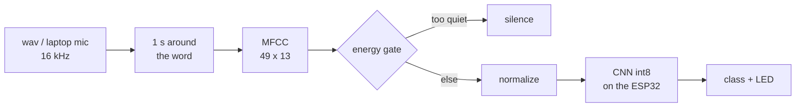
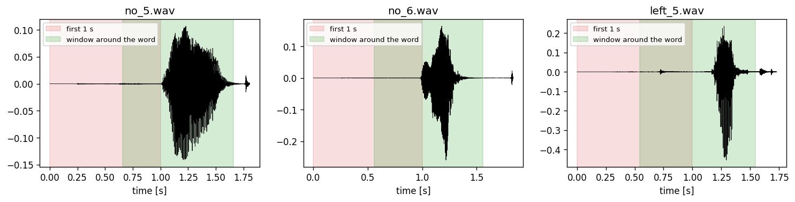

# Keyword spotting on an ESP32 (yes / no / left / right)

**Author:** MohammadMahdi Faraji
**Course:** Machine Learning (Prof. Hamed Baghban). This was my final project; I reworked it after the course.

A small CNN recognizes four spoken words and runs on an ESP32 with TensorFlow Lite Micro. It also has a *silence* and an *unknown* class, so it doesn't call every sound a keyword. With the live demo you say a word into the laptop microphone, and the ESP32 answers and turns on the LED of that word.

<p align="center"></p>

## At a glance

| | |
|---|---|
| Keywords | yes, no, left, right |
| Extra classes | silence, unknown (any other word) |
| Hardware | ESP32-WROOM-32 DevKit (240 MHz) |
| Audio | 16 kHz mono, 1 s windows |
| Features | MFCC, 49 frames × 13 coefficients |
| Model | small CNN, 51,142 parameters, int8 (58 KB) |
| Runtime | TensorFlow Lite Micro (`tflm_esp32` library, Arduino) |
| Test accuracy (unseen speakers) | 93.7 % on 6 classes, 94.9 % of the keywords recognized (int8 model as it runs on the ESP32) |
| False alarms | 7.2 % of silence / other words reported as a keyword |
| Time on the ESP32 | 78 ms per clip |
| Our own 27 recordings | 25 / 27 correct |

## Results

The test set has 2,467 clips from 233 speakers that are not in the training or validation data. I only used it for these numbers; the choice between the two models was made on the validation set.

| | CNN (on the ESP32) | MLP (architecture of my first version) |
|---|---:|---:|
| parameters | 51,142 | 90,310 |
| validation accuracy (int8) | 95.2 % | 90.6 % |
| test accuracy, float32 → int8 | 93.7 % → 93.6 % | 89.1 % → 89.1 % |
| keyword accuracy (int8) | 94.9 % | 89.7 % |
| false alarms (int8) | 7.2 % | 11.7 % |
| model size (int8) | 58 KB | 92 KB |
| our own 27 recordings | 25 / 27 | 22 / 27 |

- Keyword accuracy and false alarms are for the int8 model + energy gate, exactly like on the ESP32.
- Silence is recognized well (95 %).
- Other words are the hardest class: about 10 % of them are taken for a keyword, most often for *no*.
- When a keyword is missed, the answer is usually *unknown* (about two thirds of the misses), not a wrong keyword.

**On the ESP32** (full output in [`results/esp32_serial_log.txt`](results/esp32_serial_log.txt)):

| | |
|---|---|
| stored clips (our 27 recordings + 1 clip of digital silence) | 27 / 28 correct |
| same prediction as TFLite in Python | 27 / 28 (one borderline clip, see [notes](docs/evaluation_notes.md#esp32-vs-python)) |
| time per clip (normalize + quantize + network) | 78 ms |
| tensor arena / flash / RAM | 15.3 KB / 507 KB (38 %) / 73 KB (22 %) |

**Live test with the laptop microphone:** 24 rounds, 4 of each class. Both models got the same saved recordings:

| | 4 classes only (first rebuild) | final model |
|---|---:|---:|
| keywords (16) | 13 | 13 |
| silence (4) | 0, it always said a keyword | 4 |
| other words (4) | 0, it can't reject them | 3 |
| **total** | 13 / 24 | **20 / 24** |

## Hardware

| Part | What it is for |
|---|---|
| ESP32-WROOM-32 DevKit | runs the model; connected to the laptop with USB |
| laptop microphone | records the audio for the live demo |
| 4 LEDs + 220–330 Ω resistors (optional) | show which keyword was recognized |

| LED | ESP32 pin |
|---|---|
| yes | GPIO 5 |
| no | GPIO 18 |
| left | GPIO 19 |
| right | GPIO 21 |

Each LED goes from its pin through a resistor to GND. For *silence* and *unknown* all LEDs stay off. The board works without LEDs too; the result is also printed on the serial port.

## How it works



- **Data:** Speech Commands v0.02.
  - Keywords: 15,564 clips.
  - *Unknown*: about every 22nd clip of the other 31 words.
  - *Silence*: pieces of the dataset's background noise files at random volume, 10 % just zeros.
  - The split is by speaker, using the official lists.
- **Features:** exactly 1 s of audio → MFCC (30 ms window, 20 ms hop, 40 mel bands). Short clips get zeros at the end of the audio. From longer clips I cut the 1 s around the word.
- **Training:**
  - Every training clip is used a second time with a random time shift and some background noise.
  - MFCCs are normalized per coefficient with values from the training set.
  - Adam with early stopping on the validation loss.
- **CNN:** 3 conv layers (3×3; 16, 32 and 32 filters), 2 max-pools → dense 32 → 6 outputs.
- **Energy gate:** if even the loudest frame of a clip is very quiet, the ESP32 doesn't run the network and just says *silence*. The threshold comes from the training keywords; no test keyword is below it.
- **ESP32:** int8 model, with convolutions quantized per channel and dense layers per tensor. The notebook writes three header files (model, settings, test clips) that the sketch includes directly.

<p align="center"></p>

## Our own recordings

27 clips (16 kHz mono, 1.45–1.85 s) that I recorded with Audacity on my laptop with my roommates (with their permission). All speakers are male. In three of them the word only starts after the first second, which my old code never looked at. Cutting the 1 s around the word fixed this (CNN: 24 → 25 / 27):

<p align="center"></p>

The files are in [`data/own_recordings`](data/own_recordings), and the prediction for every file is in [`results/own_recordings_predictions.csv`](results/own_recordings_predictions.csv).

## What I changed compared to my course project

My first version had several bugs. The split was random, so the same speakers were in train and validation. The ESP32 got the features in a different order and without normalization. The class names in the sketch were in the wrong order, so the demo only looked correct by luck. And the sketch didn't even compile.

The full list is in [`docs/changes_from_course_project.md`](docs/changes_from_course_project.md), and my original files are in [`legacy/original_course_submission`](legacy/original_course_submission).

## Things I only found out on the real board

1. **Per-channel dense layers:** TensorFlow 2.21 quantizes dense layers per channel, and TFLite Micro on the ESP32 refused to run the model (*"FullyConnected per-channel quantization not yet supported"*). Now the dense layers are quantized per tensor.
2. **Extra ops:** Keras `Flatten` / `Reshape` add `SHAPE`, `STRIDED_SLICE` and `PACK` operations to the model, and they all have to be added to the op resolver in the sketch.
3. **Inputs and outputs:** the int8 input on the ESP32 is exactly the same as in Python. The outputs only differ in borderline cases, because the int8 kernels are different.
4. **Silence:** a model without a silence class says "left" or "no" when nobody talks. This is why I added the silence and unknown classes.

## How much to trust these numbers

The test set is the only fully independent result. My own recordings and the live test influenced some decisions and are small (27 and 24 clips), so their numbers are probably a bit too good. Details are in [`docs/evaluation_notes.md`](docs/evaluation_notes.md).

## Files

```
├── notebooks/keyword_spotting.ipynb   training, evaluation, int8 conversion, header files for the ESP32
├── firmware/kws_esp32/                ESP32 sketch + the 3 generated header files
├── tools/
│   ├── live_demo.py                   laptop microphone -> MFCC -> ESP32 (free mode / quiz / wav files)
│   └── kws_features.py                MFCC with numpy only (same as librosa in the notebook)
├── models/                            keras and int8 tflite models, normalization values
├── results/                           metrics, predictions, plots, ESP32 output
├── data/own_recordings/               our 27 recordings
├── docs/                              changes from the course project, notes on the evaluation
└── legacy/original_course_submission/ my original course project
```

## How to run

**Training (Colab)**
1. Open `notebooks/keyword_spotting.ipynb` in Colab and choose a GPU runtime.
2. Click *Runtime → Run all*. When it asks, upload `data/own_recordings` as a zip.
3. It takes about 10 minutes. At the end `kws_outputs.zip` is downloaded.

Tested with TensorFlow 2.21, Keras 3.13 and librosa 0.11 (`notebooks/requirements.txt`).

**ESP32**
1. Install the Arduino IDE with the esp32 board package (3.x) and the `tflm_esp32` library.
2. If you trained again, copy the three header files from `kws_outputs.zip` into `firmware/kws_esp32`.
3. Open `kws_esp32.ino`, select *ESP32 Dev Module*, upload, and open the Serial Monitor at 115200.

**Live demo** (ESP32 connected, Serial Monitor closed)
```bash
pip install -r requirements.txt
python tools/live_demo.py              # press Enter and say a word
python tools/live_demo.py --quiz 24    # quiz with keywords, silence and other words
python tools/kws_features.py           # check: numpy MFCC vs. the librosa features from the notebook
```

## Limitations and next steps

- **Microphone:** the audio is still recorded and processed on the laptop. The next step would be an I2S microphone (for example INMP441) with the MFCC computed on the ESP32 and continuous detection.
- **Other words:** rejecting other words works, but not perfectly. A slightly bigger model or more *unknown* data would probably help.
- **Small own test set:** 27 + 24 clips, all male speakers and one microphone.

## Acknowledgements

- Dataset: P. Warden, [*Speech Commands: A Dataset for Limited-Vocabulary Speech Recognition*](https://arxiv.org/abs/1804.03209), 2018 (CC BY 4.0).
- Prof. Hamed Baghban, for the original course project.
- I used an AI assistant to help review and rewrite the code, to clean it up and prepare it for publishing.

## License

MIT, see [LICENSE](LICENSE).
