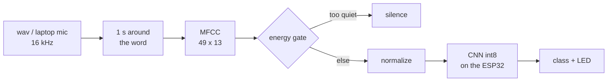
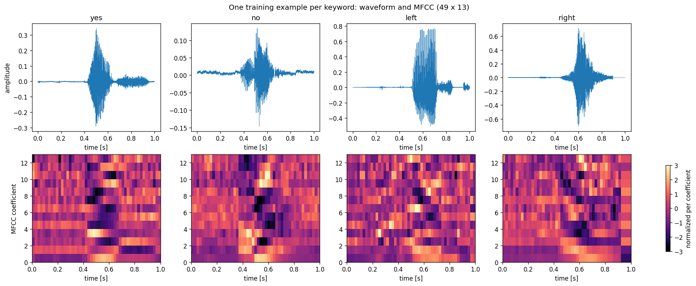

# Keyword spotting on an ESP32 (yes / no / left / right)

This was my final project for the Machine Learning course (Prof. Hamed Baghban). A small neural network recognizes four spoken words and runs on an ESP32 microcontroller with TensorFlow Lite Micro. After the course I went through the project again, found quite a few bugs in my original version, and rebuilt it.

The final version:
- is trained on Google Speech Commands with a split by speaker
- uses a small CNN that is quantized to int8 (58 KB)
- runs on the ESP32 in 78 ms per clip
- has two extra classes, *silence* and *unknown*, so it doesn't call every sound a keyword
- comes with a live demo: you say a word into the laptop microphone and the ESP32 answers

<p align="center"></p>

## Results

The test set has 2,467 clips from 233 speakers that are not in the training or validation data: 1,632 keywords, 408 silence clips and 427 clips of other words. I only used it for these numbers. The choice between the two models was made on the validation set.

| | CNN (on the ESP32) | MLP (architecture of my first version) |
|---|---:|---:|
| parameters | 51,142 | 90,310 |
| validation accuracy (int8) | 95.2 % | 90.6 % |
| test accuracy, float32 → int8 | 93.7 % → 93.6 % | 89.1 % → 89.1 % |
| keyword accuracy (int8) | 94.9 % | 89.7 % |
| false alarms (int8) | 7.2 % | 11.7 % |
| model size (int8) | 58 KB | 92 KB |
| our own 27 recordings | 25 / 27 | 22 / 27 |

- **keyword accuracy:** how many of the spoken keywords are recognized as the right keyword.
- **false alarms:** how many silence / other-word clips are wrongly reported as a keyword.
- The int8 numbers include the energy gate that also runs on the ESP32 (see below).
- **Silence** is recognized well (95 %).
- **Other words** are the hardest class: about 10 % of them are taken for a keyword, most often for *no*.
- When a keyword is missed, about two thirds of the time the answer is *unknown* and not a wrong keyword.

### On the ESP32

ESP32-WROOM-32 DevKit at 240 MHz, arduino-esp32 3.0.7, library `tflm_esp32` 2.0.0. The full output is in [`results/esp32_serial_log.txt`](results/esp32_serial_log.txt).

| | |
|---|---|
| stored clips (our 27 recordings + 1 clip of digital silence) | 27 / 28 correct |
| same prediction as the TFLite interpreter in Python | 27 / 28 (see below) |
| time per clip (normalize + quantize + network) | 78 ms |
| tensor arena used | 15.3 KB |
| flash / RAM of the sketch | 507 KB (38 %) / 73 KB (22 %) |

The one clip where the ESP32 and Python disagree (`left_7`) is a borderline case. Python gives *no* with 0.50, the ESP32 gives *left* with 0.63. The ESP32 uses its own optimized int8 kernels, which round a bit differently than the interpreter on the PC.

### Live test with the laptop microphone

With [`tools/live_demo.py`](tools/live_demo.py) the laptop records a word and computes the MFCCs. It sends them over USB to the ESP32, which runs the network, turns on the LED of the word and sends the answer back. In quiz mode the script asks for random keywords, silence or other words, and counts how many the ESP32 gets right.

I did a quiz with 24 rounds (4 of each class) and saved the recordings. The table compares my first rebuild (only the 4 word classes) with the final model, both on the same 24 recordings:

| | 4 classes only | final model (6 classes) |
|---|---:|---:|
| keywords (16) | 13 | 13 |
| silence (4) | 0, it always said a keyword | 4 |
| other words (4) | 0, it can't reject them | 3 |
| **total** | 13 / 24 | **20 / 24** |

One of the 16 keyword recordings was actually empty (nothing was said while it was recording), so both models missed it.

## How it works



**Data**
- Keywords: *yes, no, left, right* from Speech Commands v0.02 (15,564 clips).
- *Unknown*: about every 22nd clip of the other 31 words (about 4,100 clips). I pick them with a hash of the file name, so it is always the same set.
- *Silence*: 1 s pieces of the dataset's background noise files, with random volume. 10 % are just zeros.
- **Split:** I use the official `validation_list.txt` / `testing_list.txt`, so every speaker is only in one of train, val or test. The noise files are split by time (80 / 10 / 10 %).

**Features**
- Exactly 1 s of audio → 49 frames × 13 MFCC (30 ms window, 20 ms hop, 40 mel bands).
- Shorter clips get zeros at the end of the *audio*.
- From longer clips (our recordings) I cut the 1 s window around the word.

**Training**
- Every keyword / unknown training clip is used a second time with a random time shift and some background noise.
- MFCCs are normalized with mean / std per coefficient from the training set.
- Adam (lr 1e-3), early stopping on the validation loss. The CNN had its best validation loss after 14 epochs.

**CNN:** 3 conv layers (3×3, 16-32-32 filters) with 2 max-pools → dense 32 → 6 outputs.

**Energy gate:** if even the loudest frame of a clip is very quiet (first MFCC coefficient below a threshold), the ESP32 doesn't run the network and just says *silence*.
- The threshold comes from the training keywords. No test keyword is below it.
- It catches about half of the silence clips, and the silence class handles the rest.

**ESP32:**
- The model is quantized to int8: convolutions per channel, dense layers per tensor (see below).
- The notebook writes three header files (model, settings, test clips), which the sketch includes directly. So nothing has to be copied by hand anymore.

<p align="center"></p>

## Our own recordings

27 clips (16 kHz mono, 1.45–1.85 s) that I recorded with Audacity on my laptop, with my roommates, in our dorm room (with their permission). All speakers are male. The files are in [`data/own_recordings`](data/own_recordings), and the prediction for every file is in [`results/own_recordings_predictions.csv`](results/own_recordings_predictions.csv).

In three of the clips the word only starts after the first second, which my old code never looked at:

<p align="center"></p>

| input to the model | MLP | CNN |
|---|---:|---:|
| first 1 s (like my old code) | 20 / 27 | 24 / 27 |
| 1 s around the word | 22 / 27 | **25 / 27** |

The CNN's two mistakes are `no_5` (→ *unknown*) and `left_7` (→ *no* with 0.50 in Python; on the ESP32 it is correct, see above).

## What I changed compared to my course project

My original files are in [`legacy/original_course_submission`](legacy/original_course_submission), with a list of where each problem is in the code.

| Problem in my first version | What it caused | What I did |
|---|---|---|
| random 80/20 split | the same speakers were in train and validation, so the 93.6 % I reported was too optimistic | official split by speaker + a separate test set |
| MFCC padded to 50 frames, but 1 s clips only have 32 | 36 % of the inputs were always zero, so the model only used the first second | exactly 1 s of audio, padding on the audio |
| test clips cut from the start | in 3 of my clips the word came later | 1 s window around the word |
| one test file was there twice | 28 clips reported, only 27 different | duplicates are skipped (checked with a hash) |
| only the 4 words as classes | silence or any other word was always reported as a keyword | silence and unknown classes + energy gate |
| scaler fitted on all data and never saved | the ESP32 got raw MFCC values | mean / std from the training set, exported to the ESP32 |
| features for the ESP32 made in a different order | wrong input on the ESP32 | one feature function for everything |
| wrong order of the class names in the sketch | wrong labels; the demo only looked right by luck | class names written to the header by the notebook |
| missing `;` in the sketch | it did not compile | fixed and checked with arduino-cli |
| float32 model, 361 KB | big and slow | int8, 58 KB |

## Things I only found out on the real board

1. **Per-channel dense layers:** TensorFlow 2.21 quantizes dense layers per channel, and TFLite Micro on the ESP32 refused to run the model (*"FullyConnected per-channel quantization not yet supported"*). Now the dense layers are quantized per tensor.
2. **Extra ops:** Keras `Flatten` / `Reshape` add `SHAPE`, `STRIDED_SLICE` and `PACK` operations to the model, and they all have to be added to the op resolver in the sketch.
3. **Inputs and outputs:**
   - I checked that the int8 input on the ESP32 is exactly the same as in Python.
   - The outputs are the same except for borderline cases, because of the different int8 kernels (see `left_7` above).
4. **Silence:** a model without a silence class says "left" or "no" when nobody talks. This is why I added the silence and unknown classes.

## How much to trust these numbers

- **Test set:** only the test set is a really independent result. It was not used for any decision.
- **Our recordings and the live test** were never used for training, but they did influence some decisions:
  - The window around the word was added after I saw that three of my clips start late.
  - The margin of the energy gate was chosen after I looked at the volume of my laptop's silence.
  - I chose the 6-class version after the live quiz.

  So these numbers are probably a bit too good. With only 27 and 24 clips they are also not very precise: 25 / 27 means somewhere between about 76 % and 98 % with 95 % confidence.
- **Silence:** the silence test clips come from the same 6 noise files as the training clips, only from different parts of them. So the silence result is probably optimistic. I did not test in a really noisy room.
- **Live test:** these numbers come from playing the saved recordings to the ESP32 again, not from the live session itself.
- **Training runs:** results change a little between training runs (GPU). In two training runs with the same settings the CNN had 93.3 % and 93.7 % test accuracy.

## Files

```
├── notebooks/keyword_spotting.ipynb   training, evaluation, int8 conversion, header files for the ESP32
├── firmware/kws_esp32/                ESP32 sketch + the 3 generated header files
├── tools/
│   ├── live_demo.py                   laptop microphone -> MFCC -> ESP32 (free mode / quiz / wav files)
│   └── kws_features.py                MFCC with numpy only (same as librosa in the notebook)
├── models/                            keras and int8 tflite models, normalization values
├── results/                           metrics, predictions, plots, ESP32 output
├── data/own_recordings/               our 27 recordings
└── legacy/original_course_submission/ my original course project
```

## How to run

**Training (Colab)**
1. Open `notebooks/keyword_spotting.ipynb` in Colab and choose a GPU runtime.
2. Click *Runtime → Run all*. When it asks, upload `data/own_recordings` as a zip.
3. It takes about 10 minutes. At the end `kws_outputs.zip` is downloaded.

Tested with TensorFlow 2.21, Keras 3.13 and librosa 0.11 (see `notebooks/requirements.txt`).

**ESP32**
1. Install the Arduino IDE with the esp32 board package (3.x) and the `tflm_esp32` library.
2. If you trained again, copy the three header files from `kws_outputs.zip` into `firmware/kws_esp32`.
3. Open `kws_esp32.ino`, select *ESP32 Dev Module*, upload, and open the Serial Monitor at 115200.
4. LEDs (optional): GPIO 5 = yes, 18 = no, 19 = left, 21 = right.

**Live demo** (ESP32 connected, Serial Monitor closed)
```bash
pip install -r requirements.txt
python tools/live_demo.py              # press Enter and say a word
python tools/live_demo.py --quiz 24    # quiz with keywords, silence and other words
```

**Check of the numpy MFCC** (compares it with the librosa features from the notebook)
```bash
python tools/kws_features.py
```

## Limitations and next steps

- **Microphone:** the audio is still recorded and processed on the laptop. The next step would be an I2S microphone (for example INMP441) with the MFCC computed on the ESP32 and continuous detection.
- **Other words:** rejecting other words works, but not perfectly. A slightly bigger model or more *unknown* data would probably help.
- **Small test set:** our own recordings are few (27 + 24 clips), all male speakers and one microphone.

## Acknowledgements

- Dataset: P. Warden, [*Speech Commands: A Dataset for Limited-Vocabulary Speech Recognition*](https://arxiv.org/abs/1804.03209), 2018 (CC BY 4.0).
- Prof. Hamed Baghban, for the original course project.
- I used an AI assistant to help review and rewrite the code, to clean it up and prepare it for publishing.

## License

MIT, see [LICENSE](LICENSE).
