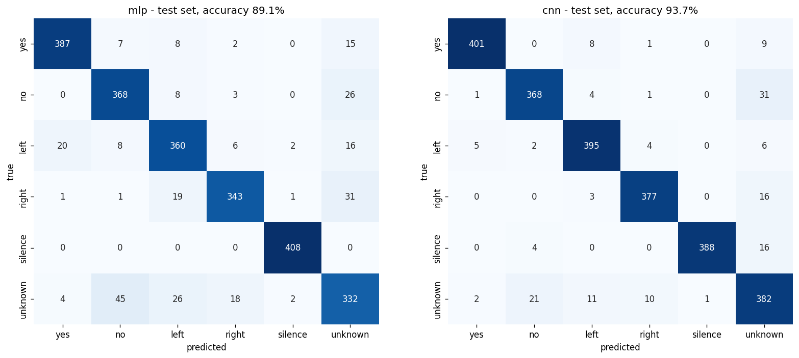
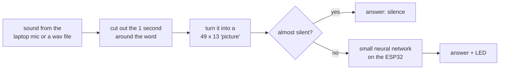

# Keyword spotting on an ESP32: teaching a tiny chip to understand yes, no, left and right

**Author:** MohammadMahdi Faraji
**Course:** Machine Learning (Prof. Hamed Baghban). This started as my final project, and I rebuilt it after the course.

You say "left" into the microphone, and a moment later a small LED on the board lights up. The interesting part is where the decision is made. It doesn't happen on a server, and it doesn't happen on the laptop. It happens on an ESP32, a cheap microcontroller with only about 320 KB of RAM for the program. That's less memory than a single photo on your phone.

<p align="center"></p>
<p align="center"><sub>How the model answers on the test set. Every row is the word that was really said, every column is what the model heard. A perfect model would only have numbers on the diagonal.</sub></p>

## What this project is about, in plain words

Smart speakers don't send everything you say to the internet. A small piece of software inside them listens all the time for one special word ("Alexa", "Hey Google"), and only when it hears that word does the rest wake up. This is called **keyword spotting**. The hard part is that it has to run on very weak, cheap hardware, all day long, without draining the battery.

In this project I built a keyword spotter for four words: **yes, no, left and right**. A small neural network learns to tell them apart, and then I shrink it until it fits on an ESP32.

The model also knows two extra answers. One is **"silence"** (nobody is talking) and the other is **"unknown"** (someone said a different word). This sounds like a detail, but it isn't. A model that only knows four words will happily call a cough or a door slam "left", because it has no other option. I learned this the hard way during the live test, so the rebuild has these two classes.

## At a glance

| | |
|---|---|
| Words it understands | yes, no, left, right |
| Extra answers | silence, unknown (any other word) |
| Hardware | ESP32-WROOM-32 DevKit (240 MHz) |
| Input | 1 second of sound, 16 kHz, mono |
| Model | small CNN, 51,142 parameters, 58 KB after compression |
| Accuracy on new speakers | 93.7 % over all 6 answers, 94.9 % of the keywords recognized |
| False alarms | 7.2 % of silence / other words are mistaken for a keyword |
| Time on the ESP32 | 78 ms per decision |
| Our own 27 recordings | 25 correct |

## Results

To measure the model fairly, I tested it on **2,467 clips from 233 people whose voices it had never heard during training**. Testing on new voices matters a lot. A model can look great on people it already knows and still fail on everyone else. My first version had exactly this problem (more on that below).

I trained two models and compared them:

| | CNN (the one on the ESP32) | MLP (same design as my first version) |
|---|---:|---:|
| Accuracy on the validation set, used to pick the winner | 95.2 % | 90.6 % |
| Accuracy on the test set: original → compressed | 93.7 % → 93.6 % | 89.1 % → 89.1 % |
| Keywords recognized correctly | 94.9 % | 89.7 % |
| False alarms | 7.2 % | 11.7 % |
| Size after compression | 58 KB | 92 KB |
| Our own 27 recordings | 25 / 27 | 22 / 27 |

In everyday words, this means:
- **Keywords:** out of 100 times someone says one of the four words, the CNN gets about 95 right.
- **False alarms:** out of 100 clips of silence or other words, about 7 are mistaken for a keyword.
- **Other words** are the hardest part. When one slips through, it is most often taken for "no".
- **Compression is almost free:** making the model 3.5 times smaller cost only 0.1 percentage points of accuracy.

**Does the ESP32 really get the same answers?** I stored our 27 recordings plus one clip of pure silence on the board and let it classify them. The full printout is in [`results/esp32_serial_log.txt`](results/esp32_serial_log.txt).

| | |
|---|---|
| Correct answers on the board | 27 / 28 |
| Same answer as the computer | 27 / 28 (the one difference is a borderline case, see [the notes](docs/evaluation_notes.md#esp32-vs-python)) |
| Time per decision | 78 ms |
| Memory used | 15.3 KB working memory for the model, 507 KB of flash (38 %), 73 KB of RAM (22 %) |

**Live test with the laptop microphone.** I played a 24-round game with the board. The script tells me what to do: say a keyword, stay silent, or say some other word. Then it checks the board's answer. I compared the final model with my first rebuild, which only knew the four words:

| | 4 words only (first rebuild) | final model |
|---|---:|---:|
| Keywords (16 rounds) | 13 | 13 |
| Silence (4 rounds) | 0, it always "heard" a word | 4 |
| Other words (4 rounds) | 0, it can't say "I don't know this" | 3 |
| **Total** | 13 / 24 | **20 / 24** |

## How it works, step by step



**1. Cut out one second around the word.** The network always expects exactly one second of sound. When a recording is longer, I find the loudest one-second window (that's where the word is) and place the word in the middle. My old code simply took the first second. In three of my recordings the word came later, so the model never even heard it.

**2. Turn the sound into a small picture.** One second of audio is 16,000 numbers, and that's too much raw data for a tiny chip. So the sound is turned into **MFCC features**. Think of a picture with 49 columns, one every 20 ms. Each column has 13 numbers that describe the "color" of the sound at that moment, meaning which frequencies are strong and which are weak. Every word leaves its own pattern in this picture:

<p align="center"></p>

**3. Let a small neural network look at the picture.** The network is a small **CNN** (convolutional neural network). It slides a tiny 3×3 window over the picture and learns which local patterns belong to which word, a bit like recognizing a face by its eyes and nose wherever they are in the photo. It has three of these layers and about 51,000 parameters. Big speech models have millions or billions.

**4. Shrink the network so it fits.** Normally every number in the network is stored with 32 bits. I convert them to 8-bit integers (**int8 quantization**), which is a bit like rounding prices to whole dollars: you lose a tiny bit of detail, but everything gets four times smaller. The model goes from 205 KB to 58 KB, and the ESP32 can calculate with whole numbers much faster.

**5. Skip the work when nobody talks.** Before running the network, the ESP32 checks how loud the clip is. If even the loudest moment is far below any normal speech, it just answers "silence" and saves the work. I set the limit from the training data, so that none of the spoken test words fall below it.

**6. Train it to deal with the real world.** During training, every clip is used a second time with a small time shift and some background noise mixed in (a running tap, someone doing the dishes, white noise). This way the model doesn't fall apart the moment the room isn't perfectly quiet.

**Where the data comes from.** The words come from Google's Speech Commands dataset (thousands of people saying short words). The "unknown" examples are other words from the same dataset, like "go", "dog" and "seven". The "silence" examples are pieces of its background-noise recordings. Every person appears only in training, only in validation or only in test, never in two of them.

## Hardware

| Part | What it does |
|---|---|
| ESP32-WROOM-32 DevKit | runs the neural network; connected to the laptop with a USB cable |
| Laptop microphone | records your voice for the live demo |
| 4 LEDs + 220–330 Ω resistors (optional) | light up to show which word was heard |

| LED | ESP32 pin |
|---|---|
| yes | GPIO 5 |
| no | GPIO 18 |
| left | GPIO 19 |
| right | GPIO 21 |

Each LED goes from its pin through a resistor to GND. For "silence" and "unknown" all LEDs stay off. You don't need the LEDs, because the board also prints every answer on the serial port.

## Our own recordings

Numbers on a public dataset are nice, but the real question is: does it work on a different microphone, in a different room, with voices it has never heard? So I recorded 27 clips with Audacity on my laptop, together with my roommates (with their permission), in our dorm room. All speakers are male.

These recordings are 1.5 to 1.8 seconds long. In three of them the word only starts after the first second. My old code only looked at the first second, so for those three it was listening to silence:

<p align="center"></p>

With the window around the word, the CNN gets 25 of the 27 clips right (24 with my old way of cutting). The files are in [`data/own_recordings`](data/own_recordings), and the answer for every file is in [`results/own_recordings_predictions.csv`](results/own_recordings_predictions.csv).

## What went wrong in my first version

When I looked at my course project again, I found more problems than I expected.
- **The split was random,** so the same people were in the training and the validation data. The 93.6 % I reported back then was too optimistic.
- **The board got wrong input.** It received the features in a different order than during training, and without the scaling the model was trained with.
- **The names of the words were in the wrong order** in the Arduino code. In my demo the model actually heard "right", and the wrong name table printed "yes". So the demo only looked correct because two mistakes cancelled each other out.
- **The final sketch didn't even compile** because of a missing semicolon.

The full list is in [`docs/changes_from_course_project.md`](docs/changes_from_course_project.md). My original files are in [`legacy/original_course_submission`](legacy/original_course_submission), so you can check every point yourself.

## Things only the real board could teach me

Everything worked on the computer, but the board still had a few surprises:
1. **The first model was refused.** TensorFlow 2.21 stores the dense layers in a way ("per-channel quantization") that the TensorFlow Lite Micro version on the ESP32 doesn't support yet. The board stopped at start-up, so now these layers are stored "per tensor".
2. **Hidden operations.** The Keras `Flatten` layer quietly adds three small operations (`SHAPE`, `STRIDED_SLICE`, `PACK`) to the model. The board must know all of them, or it refuses to start.
3. **Almost identical, but not quite.** I checked that the board gets exactly the same input numbers as the computer. Even so, in borderline cases the answer can differ, because the ESP32 uses its own fast math routines that round a little differently.
4. **Silence is not "nothing".** In the first live test, the model confidently answered "left" or "no" while nobody was talking. That's when I added the silence and unknown classes.

## How much to trust these numbers

The test set is the only completely fair result, because it played no role in any decision. My own recordings and the live test were never used for training. But they did influence some choices (for example, the window around the word), and they are small (27 and 24 clips). So take those numbers as a good sign, not as a precise measurement. The details are in [`docs/evaluation_notes.md`](docs/evaluation_notes.md).

## Try it yourself

**Train the model (Google Colab, about 10 minutes)**
1. Open `notebooks/keyword_spotting.ipynb` in Colab and choose a GPU runtime.
2. Click *Runtime → Run all*. When it asks, upload the `data/own_recordings` folder as a zip file.
3. At the end, `kws_outputs.zip` is downloaded. It has the models, the plots and the three header files for the board.

It was tested with TensorFlow 2.21, Keras 3.13 and librosa 0.11 (see `notebooks/requirements.txt`).

**Put it on the ESP32**
1. Install the Arduino IDE with the esp32 board package (3.x) and the `tflm_esp32` library.
2. If you trained a new model, copy the three header files from `kws_outputs.zip` into `firmware/kws_esp32`.
3. Open `kws_esp32.ino`, choose *ESP32 Dev Module*, upload, and open the Serial Monitor at 115200 baud. The board first tests itself on the stored clips and prints the results.

**Talk to it** (board connected, Serial Monitor closed)
```bash
pip install -r requirements.txt
python tools/live_demo.py              # press Enter, say a word, see what the board heard
python tools/live_demo.py --quiz 24    # the script tells you what to say and keeps score
```

## Files

```
├── notebooks/keyword_spotting.ipynb   the whole training story: data, features, models, compression, export
├── firmware/kws_esp32/                the Arduino code for the ESP32 + 3 header files made by the notebook
├── tools/
│   ├── live_demo.py                   laptop microphone -> board, with free mode, quiz mode and wav files
│   └── kws_features.py                the same features as the notebook, but with numpy only
├── models/                            the trained models (keras and int8 tflite)
├── results/                           numbers, plots, answers for every recording, the board's printout
├── data/own_recordings/               our 27 recordings
├── docs/                              what changed since the course project, notes on the evaluation
└── legacy/original_course_submission/ my original course project, untouched
```

## What's next

- **A real microphone on the board.** Right now the laptop records the sound and prepares it. The next step is an I2S microphone (for example the INMP441) and computing the features on the ESP32 itself, so the board can listen on its own all the time.
- **Saying "I don't know" more reliably.** About 10 % of other words still get mistaken for a keyword. A slightly bigger model or more examples of other words should help.
- **More voices.** Our own test clips are few, all from male speakers and from one microphone.

## Thanks

- Pete Warden for the [Speech Commands dataset](https://arxiv.org/abs/1804.03209) (CC BY 4.0).
- Prof. Hamed Baghban, for the course and the original project.
- My roommates, for lending me their voices.
- I used an AI assistant to help review and rewrite the code, to clean it up and prepare it for publishing.

## License

MIT, see [LICENSE](LICENSE).
